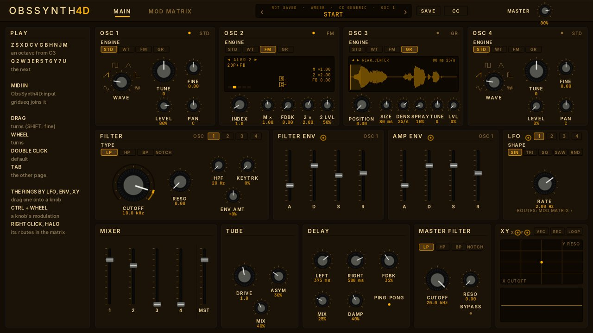
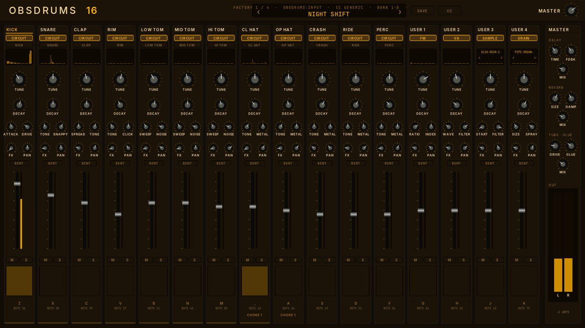
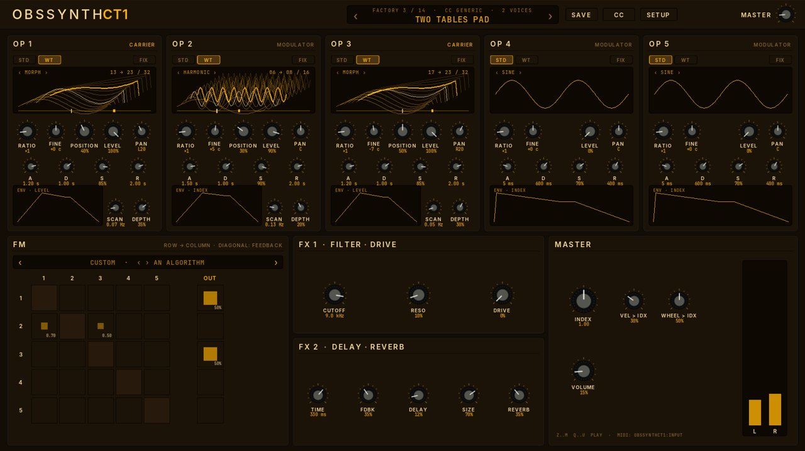
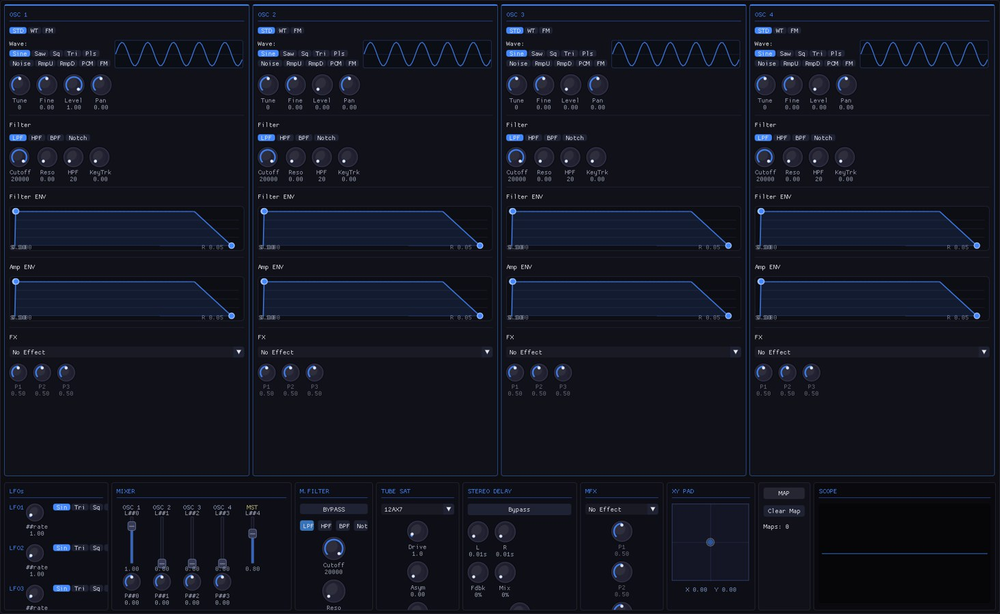

# Synth: ObsSynth4D, ObsDrums e ObsSynthCT1

Três instrumentos em **C++17** sobre o mesmo motor de síntese em tempo real (osciladores, filtros, envelopes,
mod matrix, efeitos, saída com decimador e limitador):

- **ObsSynth4D**: sintetizador de 4 osciladores (STD, wavetable, FM, granular, SUPER) com síntese vetorial, mod matrix
  e 37 presets de fábrica.
- **ObsDrums**: drum machine de 16 pads: 12 instrumentos e 4 pads livres. Cada pad tem os motores CIRCUIT
  (modelos analógicos), FM, VA, SAMPLE e GRAIN.
- **ObsSynthCT1** (*Cross Table One*): 5 operadores, cada um STD (forma clássica) ou WT (um banco de wavetable e
  sua posição, que um scan pode mover até em taxa de áudio), modulando-se por fase numa matriz 5×5 (linha modula
  coluna, a diagonal é a realimentação, OUT diz quem soa), com algoritmos prontos para começar e 14 presets.

Cada um tem seu painel desenhado como hardware em SDL3 (`obssynth4d`, `obsdrums`, `obssynthct1`), no **Linux** (Wayland, sem
X11 nem GL) e no **Windows**. Áudio: Windows **ASIO** (VB-Audio VASIO-32) → DirectSound → WaveOut; Linux
**PulseAudio** (~5 ms por bloco) → ALSA. MIDI: Linux, uma porta própria por produto (`ObsSynth4D:input`,
`ObsDrums:input`); Windows, todos os dispositivos de entrada, controladores primeiro.

---

### ObsSynth4D (`obssynth4d`)



*Página MAIN: 4 osciladores, o filtro e os envelopes do oscilador escolhido, LFO, mixer, tube, delay, master
filter, XY e scope. `Tab` abre a MOD MATRIX (fontes × destinos).*

### ObsDrums (`obsdrums`)



*Uma coluna por pad. Em cada uma: motor, circuito, o que o pad tocou por último, TUNE, DECAY, os dois knobs do
modelo, FX, PAN, BENT, nível com medidor, mute/solo e o pad. À direita, o master (delay, reverb, tube e glue,
saída).*

### ObsSynthCT1 (`obssynthct1`)



*Os 5 operadores no topo: STD ou WT, a tabela (as pontas do display trocam a forma ou o banco), RATIO (ou HZ com
FIX), FINE, POSITION, LEVEL, PAN, o envelope (o nível de um carrier, o índice de um modulador) e o scan da
posição. Embaixo, a matriz de FM, FX 1 (filtro, drive), FX 2 (delay, reverb) e o master (INDEX, velocity e wheel
sobre ele).*

PNG em resolução cheia: [obssynth4d](res/screenshots/obssynth4d.png) · [obsdrums](res/screenshots/obsdrums.png) · [obssynthct1](res/screenshots/obssynthct1.png)

---

## Usando os painéis

| | ObsSynth4D | ObsDrums | ObsSynthCT1 |
|---|---|---|---|
| Knob, fader | arrastar (Shift: fino), roda, duplo clique: padrão | igual | igual; célula da matriz: arrastar, duplo clique ou botão direito zera |
| Teclado do computador | `Z`…`M` uma oitava a partir de C3, `Q`…`U` a de cima | `Z X C V B N M ,` e `A S D F G H J K` tocam os 16 pads | como o ObsSynth4D |
| Presets / kits | `‹ nome ›` no topo, clique no nome abre a lista, `SAVE` | `‹ nome ›`, `SAVE` | `‹ nome ›`, `SAVE` |
| Páginas | `Tab`: MAIN ↔ MOD MATRIX | — | — (`‹ ›` na matriz: os algoritmos) |
| Overlay de CC | `F2` ou `CC` no topo; `Shift+F2`: próximo mapa | `F2` ou `CC`; botão direito no `CC`: próximo mapa | `F2` ou `CC`; botão direito no `CC`: próximo mapa |
| Linha de comando | `--preset NOME\|N`, `--page matrix`, `--grain arquivo.wav`, `--cc` | `--kit NOME\|N`, `--cc` | `--preset NOME\|N`, `--cc` |

Os três têm `SETUP` na barra superior (saída de áudio, entradas MIDI, canal, mapa de CC) e `--setup` para abrir nele.

**Overlay de CC.** Cada controlador tem um mapa que move os controles do painel. Com o overlay aberto, cada
controle mapeado mostra o número do CC; a etiqueta acende quando o knob físico já "pegou" o valor do painel, então
nada pula ao trocar de preset, kit ou banco. Clique num controle e mexa no controlador para aprender (*learn*);
botão direito esquece. O mapa de fábrica do **Launchkey 49** no ObsSynth4D é o da v1:

- encoders 21–28: pans dos 4 osciladores, rate do LFO 1, feedback do delay, drive e mix do tube;
- 29: chaos do tube;
- 30–33: CC A–D da matriz;
- 34–37: posição de wavetable dos 4 osciladores;
- faders 71–74: níveis dos 4 osciladores;
- faders 75–78: cutoff, ressonância, ataque e release dos 4 osciladores;
- fader 79: mix do delay.

No ObsDrums os knobs seguem o pad escolhido (um clique na coluna, ou uma batida nos pads do controlador), e os
faders 71–78 seguem o banco: pads 1–8 ou 9–16. No ObsSynthCT1 os encoders 21–25 são as posições dos 5
operadores, 26 o INDEX, 27 o cutoff, 28 o reverb; os faders 71–75 os níveis, 76 o drive, 77 o delay, 78 VEL > IDX,
79 o volume. As notas dos pads do Launchkey (36–51) tocam os 16 pads em ordem
só quando vêm dele; um sequenciador na mesma porta (o gridseq) continua tocando pelas notas de cada pad.

**Onde ficam os seus arquivos.** Linux: `~/.local/share/` (ou `$XDG_DATA_HOME`). Windows: `%APPDATA%`.

| Pasta | Conteúdo |
|---|---|
| `obssynth4d/presets/` | presets do ObsSynth4D |
| `obssynth4d/samples/` | gravações dos motores granular e SAMPLE (compartilhada com o ObsDrums) |
| `obsdrums/kits/` | kits do ObsDrums |
| `obssynthct1/presets/` | presets do ObsSynthCT1 |
| `obssynth4d/controllers/`, `obsdrums/controllers/` | mapas de CC aprendidos |

---

## Aplicações

| App | Descrição |
|-----|-----------|
| **`obssynth4d`** | painel do **ObsSynth4D** (SDL3; Linux e Windows) |
| **`obsdrums`** | painel do **ObsDrums** (SDL3; Linux e Windows) |
| **`obssynthct1`** | painel do **ObsSynthCT1** (SDL3; Linux e Windows) |
| **`ct1_proof`** | os presets do CT1 tocados offline, em WAV: `build/bin/ct1_proof pcm <pasta>` |
| **`synth_view`** | o painel da v1 do ObsSynth4D, ImGui + OpenGL, **só Windows** (ASIO, MIDI learn) |
| **`synth_cli`** | CLI MIDI → áudio em tempo real |
| **`synth_cli_v2`** | CLI baseado em `SynthEngine` (filtros por voz) |
| Exemplos / testes | `test_a4`, `test_fm_synthesis`, benchmarks, `synth_core_tests` (doctest), … |
| VST3 (**ObsSynth**) | plugin (requer o VST3 SDK, Windows) |

<details>
<summary>synth_view (v1, Windows)</summary>



| Tecla | Ação |
|-------|------|
| `1`–`9` | presets |
| `↑` / `↓` | preset anterior / próximo |
| `F1`–`F4` | cicla o FX dos osc 1–4 |
| `F5` | cicla o master FX (MFX) |
| `M` | abre/fecha a Modulation Matrix ([print](res/screenshots/synth_view_mod_matrix.png)) |
| `T` | cicla o modelo de tube |

</details>

---

## Build

### Requisitos

- **CMake** ≥ 3.20, **C++17** (Clang, GCC ou MSVC 2022/2026)
- **Linux**: ALSA; recomendado `libpulse-dev` (PulseAudio). Para os painéis: SDL3, SDL3_image, SDL3_ttf
  (Debian: `libsdl3-dev libsdl3-image-dev libsdl3-ttf-dev`). Sem eles, o CMake baixa e compila o SDL3 3.2.10,
  SDL3_image 3.2.4 e SDL3_ttf 3.2.2 (`OBS_FETCH_SDL`, padrão `ON`), só com Wayland, e para isso pede
  `libwayland-dev libxkbcommon-dev libegl-dev wayland-protocols`. Nada de X11 ou GL.
- **Windows**: Windows SDK; ASIO opcional (VB-Audio Matrix VASIO-32 para a menor latência). O SDL3 é baixado e
  compilado pelo CMake. O ImGui do `synth_view` também vem por `FetchContent`.
- `-DOBS_PANELS=OFF` desliga os painéis; `-DSYNTH_VIEW=OFF` desliga o `synth_view` no Windows.

### Linux

```bash
./install_deps.sh   # Debian/Ubuntu: ALSA, PulseAudio, SDL3, CMake
cmake -B build -DCMAKE_BUILD_TYPE=Release && cmake --build build -j"$(nproc)"
```

### Windows

```powershell
.\build_cmake.ps1
# ou Visual Studio 2026 via CMakePresets: windows-default
```

### Binários

| | Linux | Windows |
|---|---|---|
| painéis | `build/src/app/obssynth4d`, `obsdrums`, `obssynthct1` | `build\src\app\Release\obssynth4d.exe`, `obsdrums.exe`, `obssynthct1.exe` |
| synth_view | — | `build\bin\Release\synth_view.exe` |
| CLI | `build/bin/synth_cli` | `build\bin\Release\synth_cli.exe` |
| testes | `build/bin/Release/synth_core_tests` ou `ctest` em `build/` | `ctest -C Release` em `build\` |

---

## Estrutura (resumo)

```
src/
├── app/
│   ├── obssynth4d/      # painel do ObsSynth4D (SDL3), presets, mapa de CC
│   ├── obsdrums/        # painel do ObsDrums (SDL3), kits, mapa de CC
│   ├── obssynthct1/     # painel do ObsSynthCT1 (SDL3), presets, mapa de CC
│   ├── common/          # o que os painéis compartilham: desenho (panel_kit), overlay de CC,
│   │                    # áudio/MIDI por plataforma (platform_io), pastas, fontes
│   ├── synth_view/      # painel da v1, ImGui, Windows (win32/)
│   └── synth_cli/, synth_cli_v2/
├── lib/
│   ├── audio/           # ASIO, WASAPI, DirectSound, WaveOut, ALSA, Pulse
│   ├── oscillators/     # osc, ADSR, LFO, wavetable, FM
│   ├── effects/         # reverb, chorus, tube, delay, bus glue, …
│   ├── synth/           # engine, chains, mod matrix, core DSP (decimador, saída, grãos), drums/ (modelos de bateria)
│   └── utils/           # MIDI (common / win / linux), WAV, logger
├── products/
│   ├── obs_synth/       # ObsSynth4D: motor, presets
│   ├── obs_drum/        # ObsDrums: pads, choke, matriz, master, kits
│   └── obs_ct1/         # ObsSynthCT1: tabelas (mips por oitava), operadores, matriz de FM, algoritmos, presets
├── examples/            # demos e testes manuais
└── vst/                 # plugin VST3 (SDK externo)
tests/                   # doctest
res/screenshots/         # prints
docs/                    # notas de implementação; docs/mockups/ os mock-ups dos painéis
```

---

## Documentação extra

- [`docs/`](docs/): ASIO, reverb, FM, dispositivos MIDI, VST, Raspberry Pi, …
- [`docs/mockups/`](docs/mockups/): mock-ups dos painéis
- [`CHANGELOG.md`](CHANGELOG.md)

---

## Releases

[github.com/orianbsilva/obssynth/releases](https://github.com/orianbsilva/obssynth/releases). Scripts:
`create_release.sh` / `create_release.bat`. CI em `.github/workflows/`: Ubuntu (clang, gcc) e Windows (MSVC),
com os painéis.

## Licença

GPL-3.0-only: ver [LICENSE](LICENSE) e [LICENSING.md](LICENSING.md) (o material de terceiros e as marcas).
